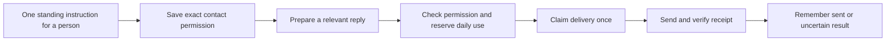

# Use saved contact permission for ordinary replies

The standing contact tool already persisted permission, but ordinary answer delivery consulted only the private automatic-reply list. Asta could therefore ask again despite the saved instruction. The reply path now consults the exact contact's durable grant and reserves its daily use atomically before calling Teams.

An explicit revocation or exhausted cap cannot fall back to the older private allowlist. Global send holds and policy rules still apply; a personal grant never grants group permission. Existing private allowlists continue working for contacts without a durable grant record.

Each automatic answer also has a durable delivery receipt keyed by its task, conversation, source and wording. Concurrent runs, restarts and lost transport receipts cannot replay it or offer the uncertain message as a fresh sendable draft. A definitive permission refusal before transport may still be staged normally. Uncertain delivery requires checking the Teams conversation before any separate retry; automatic reconciliation against Teams history is not part of this change.

Regression coverage uses fake Teams transports and isolated databases: trusted standing instruction through actual answer presentation, one-to-one scope, shared daily cap under concurrency, revocation during preflight, legacy fallback prevention, global hold/policy, concurrent delivery, cancellation, failed receipts and interrupted-process receipts. No real messages are sent.
