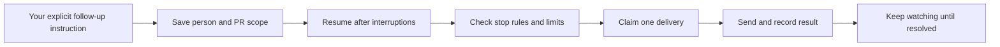

# Asta implementation checkpoint — 26 October 2026

Implementation is authorized. This is the first tested milestone of the approved roadmap, not a claim that all seven stages or the live acceptance benchmark are complete.

Base: `27d8537` on `main`, including merged changes #165, #166, #167 and #168. The remote was fetched twice and still matched this base. Work is isolated on `codex/asta-reliability`; the live checkout, services, private configuration and user data are untouched.

## What changes for Arun

- Approving the same Teams draft twice delivers it once. A restart or connection failure during delivery leaves an explicit uncertain state, never an automatic resend.
- An explicitly requested follow-up for a named person and PR set carries its authorization across restarts. The deadline warning does not ask again whether to chase. Reminders run on local weekdays, 09:00–18:00, at most one per contact per day and three per tracker. Stopping the tracker stops its future sends.
- Explicit standing permission for an exact contact is recorded immediately. Ten previous approvals are unnecessary. The grant has a visible daily cap and can be revoked; scheduled sends recheck it before delivery. Group permission is not inferred from a person's permission.
- The latest approved coding plan and its amendments survive session changes. Earlier versions remain in history. Large plans become complete `plan.md` artifacts that workers can read, rather than silently losing requirements at character limits.
- Project flow evidence takes priority over optional notes. Context omissions are visible and recorded for debugging.
- New memory facts no longer overwrite an earlier fact with a colliding filename. App actions whose checks fail are reported as unverified.
- Self-learning candidates stay out of the active playbook catalog until independent validation. Configuration experiments run only in the benchmark child process. Missing safety results reject an experiment.

## Regression ledger

| Finding | Implemented change | Evidence |
|---|---|---|
| F1: compact `gh api -XPOST` evaded the shim | Parse compact and separated method flags consistently | Fake downstream executable never reached in four write variants |
| F2: missing token disabled auth | Fail closed on API, login, sockets and WhatsApp reads/writes; protect workspace graph files | Auth regression tests with absent/invalid/valid credentials; real bridge HTTP handler exercised in a Node VM without pairing/network; existing API error test now authenticates explicitly |
| F3: concurrent draft approval sent twice | Atomic SQLite claim with `sending` / `send_uncertain` states | Concurrent approval, repeat approval, cancellation and restart tests |
| F4: experiment settings leaked into live process | Pass candidate overrides only to the benchmark child; require non-empty passing safety checks | Concurrent live reader sees unchanged DB and environment; rejected/empty safety results cannot pass |
| F4 additional: rollback canary captured the new setting | Capture prior value before promotion | Canary regression test checks actual prior override |
| F5: memory slug collision overwrote facts | Exclusive file creation with collision suffix | Both conflicting titles retain their own content and index references |
| F6: extracted model instructions became active immediately | Quarantine candidates; evaluate exact content before promotion; archive active predecessors | Confidence/fake validation fields cannot activate; missing/failed/changed evidence rejected |
| F7: memory path-prefix check allowed sibling folders | Resolve and compare path ancestry | Sibling-prefix and symlink escape tests |
| F8: conversation tests invoked real GitHub | Explicit offline revision fixture | Conversation suite passes without `gh` credentials or network |
| App completion was claimed despite a failed check | Return unverified and do not replay the write | Failed, empty and false checks never report Done |
| First/truncated approval could override a revision | Complete version history, latest-plan capture, amendment preservation | Revised proposal, large-plan artifact, disabled-history and fresh-session tests |
| Context budgets silently evicted flow docs | Prioritize retrieved flow docs; record omissions and manifest | Oversized notes cannot evict ordinary project evidence silently |
| Authorized follow-ups waited for another yes | Store target-bound authorization; bypass only the redundant deadline gate | Graph and legacy follow-up tests, daily/total limits, stop and revocation tests |

The old tests for first-plan-wins and truncation were deliberately changed: the audited behavior contradicted the user's latest approved revision. Active-skill tests now explicitly identify validated fixtures; runtime extraction tests still exercise the unvalidated path. No failure assertion was removed just to make the suite pass.

## Verification

The initial targeted reliability run passed 100 tests. Context/workworld checks passed 108 tests. Follow-up/permission checks passed 69 tests. Learning checks passed 78 tests. The final full regression run passed **5,083 tests**, with **28 skipped** and four existing FastAPI lifespan deprecation warnings, in 445.68 seconds. The required Teams DOM job separately passed **all 11 tests** in an isolated headless browser; its sandbox-only skip was not treated as a pass. The final bridge/status hardening was verified afterward with **40 focused tests passing**. Node syntax, Bash syntax and `git diff --check` also passed.

Tests use the existing venv with a sanitized environment, isolated test databases and no live `.env`. Node is exposed through a temporary runtime path; Swift's compiler cache is temporary. No dependencies were installed. No external messages, access requests, PR merges or deployments were performed.

## Boundaries and remaining work

- This closes specific reproduced defects, not the broader worker-isolation issue. Shell shims are not a security sandbox. Removing owner credentials from workers and enforcing server-issued task permissions across MCP/API/native execution remain necessary.
- Task/contact approval persistence is implemented for the described messaging and PR-follow-up paths. A unified implement → create PR → review → merge → inform workflow still needs target/revision-bound authorization and receipts across every operation. Existing merge gates are not removed by this milestone.
- Exact contact display names are required by the new grant tool. Directory-backed stable identity and ambiguous pronoun resolution remain future work.
- General browser/desktop task execution, the real Decision Hub setup/access workflow, and broader call/meeting state validation remain separate acceptance stages. The example document and live workflows have not been accessed.
- Plan artifacts preserve full content; generating and serving a preview `plan.md` before every design approval and automatically validating every worker's artifact read are not yet complete. The short planning prompt now requests a simple Mermaid behavior diagram.
- Context manifests describe included/omitted blocks. They do not yet provide a complete per-symbol, cross-repository freshness/provenance graph.
- Memory collision/path fixes preserve data. Project-scoped memory versioning, consolidation backups and migration validation remain to be implemented.
- Extracted lessons now wait for a trusted evaluator. The automatic evaluator-to-promotion workflow for arbitrary learned procedures is not implemented. Code-shipped evolution templates remain explicitly validated by their regression suite.
- The 70-task realistic acceptance benchmark and failure-injection suite have not run. No 10/10 rating or token-savings percentage is claimed. Measure tokens and cost per verified completed task against comparable workloads before claiming improvement.

No schema migration is required for this milestone: it uses existing task status text and KV storage. Rolling back code preserves new records, but older code will not understand the new uncertain-send state or enforce these protections; reconcile in-flight sends before any rollback. Back up normal runtime data before deploying a concrete release.

## Reproducible test record

Local logs (temporary files):

- Full regression: `/private/tmp/asta-reliability-verified-suite.log`
- Required DOM fixtures: `/private/tmp/asta-reliability-dom-verified.log`
- Final bridge/status checks: `/private/tmp/asta-reliability-bridge-final.log`
- Review regressions and the newly merged planning safeguards: `/private/tmp/asta-reliability-review-checks.log` (113 passed)
- CLI capability parity and authenticated contact permission: `/private/tmp/asta-reliability-parity.log` (29 passed)

These counts overlap and must not be added together as unique tests. The remaining environment-dependent skips are not evidence of passing live integration checks. No full live task-success, latency, cost or token-efficiency comparison has been measured yet.
