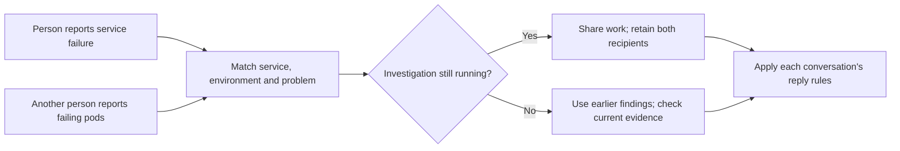

# Cross-conversation deployment investigations

A startup failure reported as a stack trace and the same failure reported as pod status used to produce unrelated investigations. The old cache compared identifiers and wording from each conversation, so incidental build numbers, old chat history and pod names hid the shared issue.

Asta now correlates an explicit service, environment and startup failure independently of the sender. Running work is shared while each recipient retains their own conversation and reply eligibility. Finished work becomes historical evidence for a focused current-state check; an old outage answer is not presented as fresh. This matters in the reported case: the second ask arrived just beyond the 15-minute cache lifetime.

Different environments, services, explicit builds, customer cases and comparison questions do not collapse into one investigation. Missing or ambiguous identity leaves the normal investigation path in place. Six-hour history and a one-hour running limit prevent indefinite reuse. Stored matching records survive restarts.

The fallback incoming-message key also includes sender and a hash of the full message. A changed build beyond the feed preview, or a second person sending identical words, must not be silently dropped as an already-handled message.

Validation includes sanitized reproductions of the stack-trace/pod reports, independent recipient retention, focused rechecks, conflicting builds, ambiguous scope, corrupt records and stale/failed work. Read-only inspection of the original two report bodies also confirmed matching service/environment identities; no live task, chat or deployment was changed.

This matcher deliberately covers explicit startup failures. Broader semantic correlation and live outcome/token benchmarks remain open; this change does not claim that every paraphrased issue will match.
