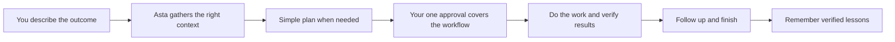
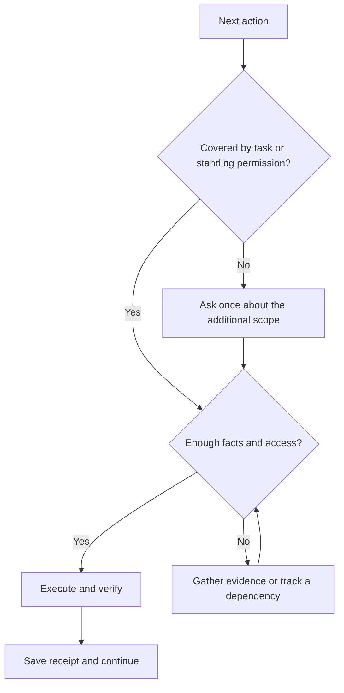
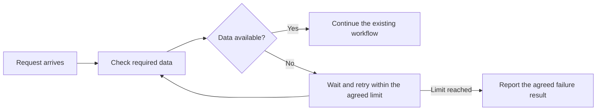
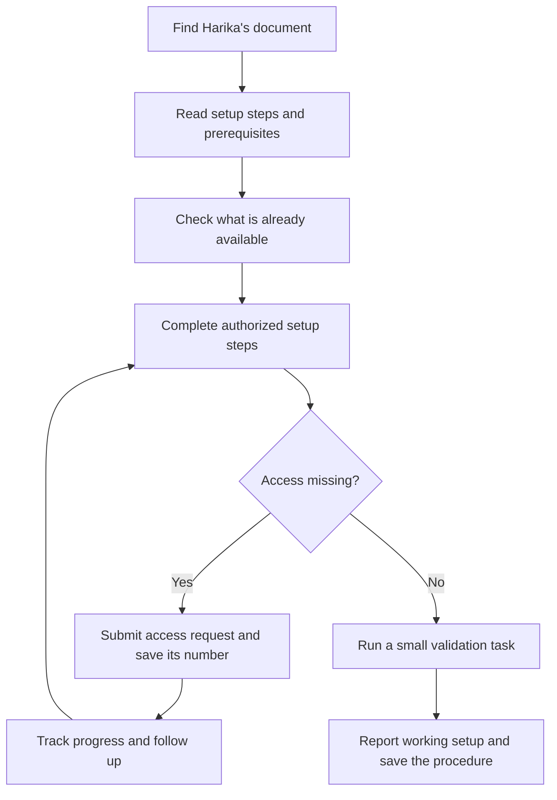
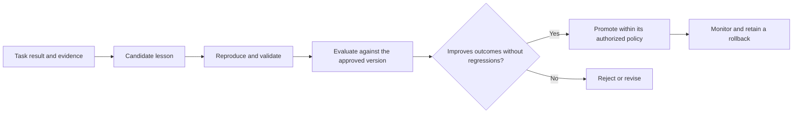

# Asta improvement plan

**Date:** 26 October 2026

**Status:** Implementation authorized by Arun on 26 October 2026; proceeding in tested stages. Live deployment is not part of this implementation milestone.

**27 October continuation:** Arun additionally authorized raising and merging the tested batches on his personal GitHub (`Arunk02/asta`). That supersedes the initial milestone's merge exclusion below. Current delivered behavior and outstanding work are tracked in [progress.md](progress.md); the original audit/checkpoint remains historical evidence.

**Repository:** `/Users/arun.k.k/help/asta`

**Audited state:** Initial audit at `a313964` with the then-existing edits. Implementation reconciled against clean `main` / `origin/main` at `27d8537`, including merged PRs #165–#168.

**Purpose:** Make Asta a dependable personal assistant that completes whole tasks, remembers what matters, and needs substantially less supervision.

This revision incorporates Arun's latest requirements. It replaces any suggestion that an already authorized workflow needs a fresh approval for each tool, recipient interaction, PR action, or restart. It preserves the earlier audit's evidence and fixes the implementation boundaries that currently make broad autonomy unreliable.

“10 out of 10” is the quality ambition. It is not a current rating or a guarantee that every unfamiliar website or task will work. Releases must earn confidence through representative task results, independently checked outcomes, and regression evidence.

## 1. The experience we are building

Arun gives Asta an outcome. Asta understands the work, gathers the relevant context, presents a clear plan when design approval is needed, and completes the authorized workflow. It keeps track of external dependencies, follows up with the right people, resumes after interruptions, and reports what actually happened.

The assistant should be able to:

- Understand and change code across the actual project and its dependencies.
- Debug from source, logs, traces, and reproducible experiments.
- Read a document shared in Teams and carry out a setup workflow, including requesting necessary access.
- Use browsers and desktop apps to complete tasks, rather than merely opening them.
- Send messages and handle related follow-ups with authorized contacts.
- Help with learning: explain, demonstrate, give exercises, check answers, and remember progress.
- Prepare for, join, and participate in authorized calls and meetings; capture decisions and pursue resulting work.
- Learn verified lessons without silently promoting guesses into operating rules.

An explicit instruction already authorizes the actions it clearly requests. The plan gate is for reviewing a coding design or resolving material scope, not for repeating the user's instruction back as a permission question.

## 2. One approval, carried through the task

### Task authority

The task stores the user's instruction and any approved plan version, together with the actions and targets it authorizes. Every execution path reads that same record: conversation tools, background workers, browser actions, app automation, resumed graphs, and scheduled follow-ups.

For a coding task, the approval card can cover: implement, test, commit, push, open the PR, review it, merge when the agreed checks pass, inform the named person, and follow up. Asta does not stop at each of these steps for another yes.

| User instruction | Intended behavior |
|---|---|
| “Raise a PR for this approved change.” | Open it and verify the resulting PR; no second approval for the requested action. |
| “Review, approve and merge this PR if it is good.” | Inspect the target revision, run/check the agreed evidence, approve and merge when conditions hold, and report receipts. If the revision changes, repeat the relevant review automatically within scope. |
| “Implement this, raise the PR, merge after checks, and send Harika the result.” | Show the coding plan once if not already approved. Its approval covers the complete stated workflow. |
| “Send him this and follow up until it is resolved.” | Send, track replies, answer in scope, and follow up without requesting approval for every message. |
| “Handle routine conversations and follow-ups with this person going forward.” | Record a standing relationship permission immediately from this explicit instruction. No requirement to first collect ten separate approvals. |
| “Stop”, “hold”, or “revoke permission for this person.” | Persist the change and stop affected work and scheduled actions. |

The task records exact account, recipient, repository, environment, and resource identities where those matter. Asta resolves them from available context; it asks only when ambiguity cannot be resolved safely. Being authorized to act does not make a missing account permission available: a repository may prohibit self-approval, and an access request may need an administrator. Those become tracked dependencies, not requests for the user to approve the same task again.

### Standing contact permissions

Support permission for a named one-to-one relationship and selected action categories: routine replies, task updates, clarification, and follow-ups. It may persist until revoked. It is not limited to resending identical words. Topic context, relevant verified facts, and the ongoing conversation determine the reply.

Distinguish task-only follow-up from the user's explicit “going forward” permission. A one-time send must not silently authorize all future unrelated activity with that person. Close contacts should make communication smoother; recipient matching must still be correct.

Proposed follow-up default: respond to relevant incoming replies promptly; send at most one unanswered reminder per working day, with three reminders before reporting the unresolved dependency. A user-specified cadence wins. Stop when resolved, withdrawn, or the recipient asks to stop. Standing relationship permission remains recorded even when one follow-up sequence ends.

### When a new question is justified

Ask for missing facts, a material expansion beyond the approved objective, or a decision the evidence cannot resolve. MFA and an external approver's action may require the user. Internal retries, model changes, routine repair, tool switches, restarts, and already authorized follow-ups do not require another approval.

Approval and verification are separate. Asta may have permission to merge and still need evidence that the merge conditions hold. It should obtain that evidence autonomously and proceed when they do.

**Implementation direction:** extend `authority.py`, `consent.py`, `go.py`, and task state around one server-owned authorization contract. The current blanket bans on worker PR approval/merge should become scope-aware through a privileged action service. Adding another natural-language exception to each CLI is not sufficient. Workers must receive limited authority, not the owner's unrestricted token.

## 3. A useful coding plan.md

Each coding task should generate a readable `plan.md` before its design approval. Store the complete artifact and a version identifier; small prompt excerpts are references to it, not the authoritative plan.

Required contents:

1. **What you asked for:** outcome and constraints in plain language.
2. **What happens today:** verified current flow, with source links.
3. **What will change:** small before/after diagram with understandable labels.
4. **Where:** affected repositories, files, contracts, and downstream services.
5. **Evidence and unknowns:** facts separated from hypotheses.
6. **How we will prove it:** reproduction, regression checks, and success criteria.
7. **What this approval covers:** implementation plus the requested PR, merge, communication, and follow-up steps.
8. **Recovery:** how to undo reversible changes and handle uncertain external actions.

Example diagram, illustrative only:

A revised approved plan supersedes the earlier version while preserving its history. Implementation progress is not discarded. Routine implementation detail changes inside the agreed behavior do not create another approval gate. A material behavioral change is presented as a concise change to the plan.

## 4. Project context that survives real work

Having context files on disk is not enough. Asta must establish that the correct material was retrieved, included, read, and still applicable to the current repository revision.

For every substantial coding or debugging task:

1. Resolve workspace, repository, checkout, and relevant revision.
2. Use Asta's existing context resolver to identify entry points, symbols, linked services, project documents, and relevant regression history.
3. Check freshness against the current code and expose disagreements between documentation and implementation.
4. Read the specific source needed to validate the proposed explanation or change.
5. Build a task evidence manifest: source, revision, relevant passage, what it supports, and whether it reached the worker.
6. Carry the current approved plan, important decisions, unresolved questions, and action receipts across model switches and restarts.
7. Reacquire required material when budgets are tight. Do not silently omit a dependency or replace evidence with an invented summary.

Reserve context space for required project facts. Record dropped or deferred sources and why. Keep a small working set and retrieve more on demand instead of repeatedly attaching whole transcripts. Instruction authority must come from the user/task policy; repository files and memories remain reference data.

**Existing foundations:** `workspace/providers/indexed.py`, `project_knowledge.py`, `context_pack.py`, `context_build.py`, `task_spec.py`, and `graph/notes.py`. Improve these before adding a vector database or another framework.

### New evidence from this planning pass

| Status | Observation | Implication |
|---|---|---|
| VERIFIED by synthetic probe | `task_spec.capture()` kept version 1 after version 2 was supplied. It stores only the final 2,000 characters and ignores subsequent captures. | Replace this helper's “first approval wins” rule with explicit plan versions. Other code can prefer `task_plan`; this does not prove every resumed task currently uses stale plans. |
| VERIFIED by synthetic probe | A 4,300-character notes block caused the project-knowledge block to be omitted from a planning context pack. | Context budgeting needs evidence-aware allocation and visibility into omissions. This establishes a possible failure path, not the cause of every reported breakdown. |
| VERIFIED by synthetic probe | App execution returned success, its verification returned failure, and `app_tasks.do()` still reported “Done” with “the check returned nothing.” | Separate attempted execution from verified completion before expanding app autonomy. |

Sources: [task specification](/Users/arun.k.k/help/asta/app/task_spec.py:36), [context packing](/Users/arun.k.k/help/asta/app/context_pack.py:64), [app verification](/Users/arun.k.k/help/asta/app/app_tasks.py:229).

## 5. General browser and desktop execution

Use the best available interface: service API or connector, browser DOM/accessibility controls, native app scripting, then visual interaction when needed. The user should see progress toward the objective, not a request to choose an implementation mechanism.

Create a reusable execution loop:

**Observe → choose the next authorized action → execute → inspect the result → checkpoint → continue or recover.**

Support navigation, documents, downloads, form entry, submission, application setup, and appropriate update/trigger actions. Browser-side JavaScript may operate within authorized page functionality; it must not bypass login, access controls, or a site's authentication protections. Existing environment restrictions are replaced only by an explicitly designed, resource-scoped authorization mechanism, never by a blanket “allow everything” switch.

Each operation needs evidence appropriate to the action: a saved file, ticket number, server acknowledgment, independently reread field, PR receipt, or resulting application state. A successful click or process exit alone does not prove completion. After an interrupted submission, establish whether it already succeeded before retrying.

The existing `apps.py`, `app_tasks.py`, `screen.py`, and `sites.py` provide useful starting points. The inspected site module has reading, controls, selection, and form-planning functions; it does not by itself establish a complete general form-submission workflow. Existing AppleScript/DOM restrictions also need to be evaluated as enforcement mechanisms, not accepted because their comments call them safe.

### First end-to-end pilot: Decision Hub setup

Use the document Harika shared in Teams as the first representative setup task once implementation is ready. Its actual instructions, links, and access requirements have not been inspected in this planning pass.

The outcome distinguishes “request submitted,” “access granted,” “setup completed,” and “validation passed.” It resumes after external access approval without asking Arun to reauthorize the task. It asks for credentials/MFA through the legitimate login flow when required, rather than pretending it can grant access itself.

### Learning and research tasks

An online learning task should produce a learning plan, sourced explanations, hands-on exercises, feedback on the user's answers, and a progress record. Opening a course or website is only a step. Record demonstrated understanding separately from pages visited or time spent.

## 6. Memory with clear purpose

| Memory | Store | Retrieve | Correct and retain |
|---|---|---|---|
| Task state | Current objective, approved plan version, decisions, checkpoints, receipts | Every resume and relevant follow-up | Append changes; preserve audit history; archive completed tasks under a documented policy |
| Project knowledge | Architecture facts, source references, revision/freshness information | Coding, debugging, explanations | Refresh from changed sources; mark disagreements and superseded facts |
| Preferences and authority | Explicit preferences and task/contact permissions with provenance | Before planning and consequential actions | Inspect, correct, or revoke; permissions are evaluated in code |
| Experiences | Outcome, attempted strategy, evidence, failure category, verification | Similar tasks and recurring defects | Candidate → verified → superseded/rejected; keep only useful, appropriately redacted records |
| Relationships | Stable contact identity, relevant conversation context, commitments | Authorized communication and meeting preparation | Prevent cross-person mixing; allow correction and deletion |
| Learning progress | Topics, exercises, demonstrated strengths and gaps | Study sessions | Update from evidence; do not infer mastery from a completion message |

Use stable IDs and explicit versions, not titles as destructive filenames. Preserve source and timestamps. Exclude secrets before persistence. Define project boundaries, deletion behavior across indexes/caches, retention, export, backup, and restore. Existing data must stay readable during staged changes; no migration before a verified backup and rollback test.

Measure retrieval usefulness using known-answer tasks and whether the worker actually receives the necessary evidence. More stored text is not a success metric.

## 7. Efficient debugging and coding

The working procedure is:

**Observe → reproduce or isolate → compare hypotheses → trace the cause → make the smallest sufficient fix → test → verify affected flows.**

For distributed failures, connect source behavior, logs, metrics, and traces on one timeline. Asta should name the evidence that distinguishes competing explanations. Unavailable production reproduction is recorded as a limitation; a controlled reproduction may still establish the defective component.

Before code changes, identify callers, contracts, upstream/downstream consumers, and existing tests through the project context. Reuse validated evidence when its source revision is unchanged. Run scoped checks first and broader checks when risk or new evidence justifies them. Completion requires evidence of the requested behavior, not merely a worker saying it is done.

Debugging output should say: what failed, what was checked, the established cause or remaining hypothesis, the proposed change, and how it will be proven. Keep diagrams and the approval plan simple; keep detailed evidence available through links.

## 8. Calls and meetings as complete workflows

One instruction to call or conduct a meeting covers finding the intended person/event, preparing relevant context, joining, carrying out the agreed agenda, summarizing outcomes, and tracking in-scope follow-ups.

Improve the existing `meetings.py`, `call_mind.py`, `call_rtc.py`, and voice modules around lifecycle verification: ringing is not answered; joined is not heard; speech attempted is not successfully delivered. Test wrong-target prevention, no answer, microphone routing, reconnect, sleep/wake, and clean exit. Preserve speaker attribution and distinguish a request made during the meeting from a commitment actually accepted.

For an AI-led conversation, make Asta's assistant role clear. Recording/transcription follows applicable participant and organizational requirements. These should be handled by the workflow's established settings and legitimate access, not repeated generic approval prompts.

## 9. Self-learning and recovery

Keep recovery, memory updates, behavioral tuning, and code changes as distinct operations.

- Recover transient failures with bounded retries and timeouts; use available approved fallbacks.
- Reconcile uncertain external actions before retrying them.
- Preserve the task's authorization and progress across restarts.
- Turn verified regressions into reusable cases with incident, cause, fix, and evidence.
- Keep generated lessons provisional until validation; a high model confidence score is insufficient.
- Evaluate candidates in a separate process without modifying live settings.
- Require the complete expected safety suite to run and pass; missing results fail closed.
- Allow low-risk, verified improvements under a previously approved promotion policy, avoiding approval on every lesson.
- Keep source changes on the reviewed coding path. Learning must not alter its own permission boundary or evaluation criteria to pass.

Formal reinforcement learning remains optional. First establish reliable task outcomes and a reproducible evaluation environment.

## 10. Implementation order and acceptance

Every stage consists of small patches, preserving unrelated changes. Reproductions become regression tests before or alongside implementation. Existing public interfaces and stored data remain compatible unless a separately reviewed migration is required.

| Stage | Work and components | Acceptance | Dependencies and rollback |
|---|---|---|---|
| 1. Reliable foundations | Fix audited authentication, evaluation, duplicate-send, memory-collision, path, and false-completion defects. Add test isolation at external boundaries. | Synthetic reproductions pass as regression tests; uncertain actions are not called done; no live side effects during tests. | Begin from the current dirty-tree baseline. Back up before persistence changes; revert patches independently without discarding user work. |
| 2. One approval | Unified task/contact authority in `authority`, `consent`, `go`, task/graph state, capabilities, MCP, and workers. | Requested implement/PR/review/merge/send/follow-up workflow completes without repeated approvals, including restart. Revocation takes effect. | Stage 1. Version permission records; rollback preserves recorded grants and receipts but stops unsupported actions. |
| 3. Context and readable plans | Versioned `plan.md`, evidence manifest, freshness checks, context-budget accounting, reliable task resumption. | Revised approved plan is used; required project facts survive budgets and model switches; diagrams match inspected code. | Stages 1–2. Keep legacy plan readers while migrating; restore prior compatible metadata if necessary. |
| 4. Complete browser/app tasks | General executor and independent result checks using existing browser/app modules. First pilot: Decision Hub setup. | Setup proceeds through document, access request, waiting, resumed setup, and validation; submissions are not duplicated. | Stages 1–3. Exercise fake portals and test accounts before authorized live work. Stop scheduling and reconcile receipts before rollback. |
| 5. Communication and meetings | Relationship permissions, durable follow-ups, call/meeting lifecycle, decision/action capture. | In-scope conversation continues without repeated yes; no wrong-recipient action; call outcomes and commitments are accurate. | Stages 1–3; shared execution layer where needed. Revocable grants and recoverable task records; no attempt to undo sent messages by deleting receipts. |
| 6. Memory and learning | Versioned facts, provenance, correction/deletion, candidate lessons, verified promotion and regression ledger. | No silent overwrite; outdated facts can be corrected; unverified lessons do not enter active procedures; restore drill succeeds. | Earlier foundations and baseline metrics. Additive migration with tested backup/restore; preserve previous approved prompts and settings. |
| 7. Broader capability and optimization | Learning/research tasks, new websites/apps, measured routing and context optimization. | Representative task success improves while correctness, authority, and verification remain stable. | Fixed benchmark and coverage of the actual execution paths. Restore last approved strategy/model configuration on regression. |

Existing code already provides parts of every stage. The work is to verify and connect them, then add the missing capabilities. Do not introduce a new agent framework or database merely to label the architecture more advanced.

## 11. What a release must prove

Proposed benchmark: 70 representative tasks, ten in each area—coding, debugging, setup/browser/app work, communication/follow-up, calls/meetings, memory/context, and learning/research—plus at least 20 focused failure and authority scenarios. Establish the baseline first. Run nondeterministic cases at least three times and publish counts, failures, and variability.

Hard requirements are not averaged into a score:

- Zero unauthorized actions, wrong-recipient sends, duplicate consequential actions, silent memory loss, or false completion in the mandatory test suite.
- Zero repeated approval prompts for already authorized actions in the approval/resume suite.
- All mandatory failure, isolation, and permission tests pass; missing or skipped required cases do not count as success.
- No known high-severity regression introduced by the candidate.

Initial capability target: at least 90% independently verified completion on the representative suite, with transparent failure categories, then raise the threshold as coverage matures. This threshold is proposed, not a measured current result. Deterministic regression cases still require 100% pass.

Track first-attempt completion, recovery success, human interventions, repeated mistakes, retrieval usefulness, accepted plan revisions, follow-up resolution, latency percentiles, tokens, and cost per successful task. Report provider estimates separately from measured cost. A simple status request should use known state; a complex investigation may appropriately take longer.

Asta earns the user's “10/10” through consistently successful daily use, not through a self-assigned aggregate score.

## 12. Review boundary and next action

Arun approved implementation: “go ahead according to ur plan well, i merged few more changes into asta main repo as well check that as well”, followed by “continue and pick from where u left”. This authorizes the planned implementation and checks without another approval at each patch. The Teams/Decision Hub story remains an example, not a request to message a colleague or submit a live access request now.

Start implementation with Stage 1, followed by Stage 2 so that broader autonomy operates reliably with the user's one-approval preference. Approval may cover the whole agreed roadmap: report milestones and continue, without asking again at every patch or stage. Before each patch, preserve the current uncommitted work and confirm the regression baseline for the affected component.

This implementation milestone is isolated on `codex/asta-reliability` in `/Users/arun.k.k/help/asta-reliability`. It does not restart the live assistant, merge into main, or migrate live data. Any later deployment approval must refer to a tested concrete release. A migration design not yet specified, or a materially different deployment, is new scope and must be made concrete before it is approved. Merely restarting an already authorized workflow never invalidates its approval.

### Verification status

- Earlier audit: full isolated run reported 4,974 passed, 12 failed, and 62 skipped. Eight dependency-related failures passed with Node available; the Swift helper built with temporary compiler caches. One failure was missing Git metadata in the audit copy; two revealed unstubbed GitHub calls. This is not a claim of a fully green suite.
- This planning pass: inspected authority, consent, task specification, context retrieval/packing, browser/app execution, and call/meeting interfaces. Reproduced three additional behaviors using synthetic data and stubbed app execution.
- No Asta source, configuration, memory, databases, dependencies, or deployment was changed. Only this separate planning artifact was created.
- Harika's document, Decision Hub access, actual contact permissions, and live workflow success remain unverified. They are pilot inputs, not invented facts.

## Implementation checkpoint

The first implementation milestone and regression ledger are in `/Users/arun.k.k/help/asta-reliability/docs/asta-improvement/implementation.md`. Its completion does not mark the entire roadmap complete; that file identifies implemented behavior, tests and remaining stages.
