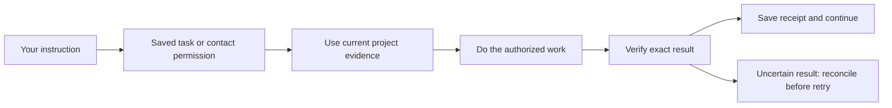

# Asta delivery record — 30 October 2026

Arun authorized implementation, PR creation and merging after checks, using his personal GitHub account. Work is isolated from the running checkout. A GitHub merge does not mean the live assistant has been restarted or its data migrated.

| Batch | Result | Evidence and limits |
|---|---|---|
| [#170](https://github.com/Arunk02/asta/pull/170), reliability foundations | Merged, including integration with the user's newer #169 changes | Authentication, atomic draft delivery, plan history, context priority, explicit contact/follow-up authority, learning quarantine. Integrated local suite: 5,090 passed, 28 skipped; final CI pytest and DOM passed. See the original implementation checkpoint for scope. |
| [#171](https://github.com/Arunk02/asta/pull/171), shared issue recognition | Merged | Running investigations can be shared for the same explicit service/environment startup failure; recent completed analysis provides evidence for a fresh check. Regression models the two-report incident. Local: 5,112 passed, 28 skipped; CI passed. Different cases, builds and environments are not silently combined. |
| [#172](https://github.com/Arunk02/asta/pull/172), memory continuity | Merged | Retains facts and episodes with immutable history; source/workspace provenance and project-filtered recall. Final focused run: 117 passed; final CI pytest and DOM passed. Earlier full run exposed two stale test mocks, which were repaired before final CI. Already lost memories are not reconstructed automatically. |
| [#173](https://github.com/Arunk02/asta/pull/173), task merge permission | Merged | Carries a requested merge through plan revisions, binds to the checked commit, preserves uncertain receipts and waits for all task PRs. Full local pre-integration batch: 5,109 passed, 28 skipped; rebased focused run: 96 passed; final CI pytest and DOM passed. |
| [#174](https://github.com/Arunk02/asta/pull/174), contact reply integration | Merged | Durable contact grants now reach ordinary answer delivery and share their daily cap. Concurrent/uncertain automatic answers retain receipts instead of becoming another sendable draft. Focused permission, reply, cross-service and follow-up run: 71 passed. Full local suite: 5,129 passed, 28 skipped. Final CI verifies the rebased branch. |

## Subsequent merged work

GitHub merge receipts were checked on 30 October. These are delivered code and regression coverage; they do not establish deployment or a successful live integration.

| PRs | Delivered behavior | Remaining boundary |
|---|---|---|
| [#175](https://github.com/Arunk02/asta/pull/175), [#176](https://github.com/Arunk02/asta/pull/176) | Repository/task-bound PR actions; measured token usage distinguished from estimates | A complete per-task cost ledger and verified-success denominator remain outstanding. |
| [#177](https://github.com/Arunk02/asta/pull/177), [#180](https://github.com/Arunk02/asta/pull/180), [#183](https://github.com/Arunk02/asta/pull/183), [#190](https://github.com/Arunk02/asta/pull/190) | Scoped worker API credentials, expired scope cleanup, server-secret filtering, registered-workspace reads | These are API/process controls, not an OS filesystem isolation boundary. |
| [#178](https://github.com/Arunk02/asta/pull/178), [#179](https://github.com/Arunk02/asta/pull/179) | One instruction can carry standalone review/approve/merge and a named task notification | Authority stays bound to the requested task, repository, action and contact. |
| [#181](https://github.com/Arunk02/asta/pull/181), [#182](https://github.com/Arunk02/asta/pull/182) | Scoped recall before limits, second-reporter context, full plan previews, memory correction/restore and context refresh | Representative real-task quality still needs measurement. |
| [#184](https://github.com/Arunk02/asta/pull/184), [#185](https://github.com/Arunk02/asta/pull/185) | Durable guide-to-setup stages, call/meeting lifecycle and isolated end-to-end tests | Real setup/access and call pilots need concrete targets and authorization. |
| [#186](https://github.com/Arunk02/asta/pull/186)–[#192](https://github.com/Arunk02/asta/pull/192) | Exact dictated sends, recipient-aware follow-up stop, restart-safe intake, delivery retries, review freshness and named draft approval | Regression coverage is not evidence that messages were sent to real contacts during this work. |
| [#193](https://github.com/Arunk02/asta/pull/193) | Requested reproduction before solution planning; fresh JUnit and production snapshot gates | Live pilot exposed stage-scope and report handling defects; see pending #197. |
| [#194](https://github.com/Arunk02/asta/pull/194) | Required named checks and exact evaluated bytes before lesson promotion | Trusted task-specific evaluators, monitoring and guarded rollback remain outstanding. |
| [#195](https://github.com/Arunk02/asta/pull/195) | All 21 mandatory gates run in CI; missing/skipped evidence fails | 88 gate test instances do not replace the 70-task repeated benchmark. |
| [#196](https://github.com/Arunk02/asta/pull/196) | Missing Claude login pauses tasks and preserves resumable sessions | 49 focused tests plus full pytest/DOM and mandatory gate CI passed before merge. |

## Active real coding pilot

The public Asta lesson-promotion pilot uses an isolated database, API and source checkout. The first worker reproduced the defects but edited production during reproduction; the guard blocked it. A subsequent worker stayed within scope, exposing report artifact/path handling defects. [PR #197](https://github.com/Arunk02/asta/pull/197) addresses these with dedicated reproduction instructions, exact-new-report exemption and unambiguous repository-relative report resolution. Its 122 focused tests pass; CI and merge are pending at this checkpoint.

After those corrections, the real worker produced fresh failing JUnit evidence for both defects with production unchanged, and the evidence gate confirmed reproduction. The same task is proceeding through plan, implementation and verification. Full coding success has **not yet been established**. The independent fix already merged in #194 is not attributed to this pilot.

Counts overlap and must not be summed. Environment-dependent skips are not proof of passing live integrations. Tests use isolated databases and fake communication transports; none of these checks messages real contacts.

## Remaining acceptance work

The seven-stage roadmap is not complete. Highest-priority outstanding work:

1. Complete an actual worker OS/filesystem boundary; scoped API credentials and shell wrappers do not provide it.
2. Connect trusted task-specific learning evaluators to promotion, isolated experiments, regression monitoring and guarded rollback.
3. Deliver learning sessions with objectives, sources, exercises, checked answers and persisted progress.
4. Complete per-task cost accounting across retries, background legs and failed attempts; distinguish measured and estimated usage and divide by verified successes.
5. Run 70 representative tasks (ten per area), repeating nondeterministic cases three times; record interventions, failures and cost.
6. Finish the real debugging/full-coding pilot first, then perform specifically authorized setup and call pilots with actual inputs.
7. Prepare deployment separately and verify behavior after deployment. No live restart was performed by this implementation continuation.

No 10/10 rating or token-saving percentage is claimed. These changes remove reproduced failure modes; an overall rating needs measured end-to-end results. No live deployment or restart is included in this record.
