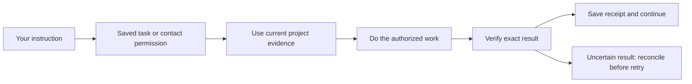

# Asta delivery record — 27 October 2026

Arun authorized implementation, PR creation and merging after checks, using his personal GitHub account. Work is isolated from the running checkout. A GitHub merge does not mean the live assistant has been restarted or its data migrated.

| Batch | Result | Evidence and limits |
|---|---|---|
| [#170](https://github.com/Arunk02/asta/pull/170), reliability foundations | Merged, including integration with the user's newer #169 changes | Authentication, atomic draft delivery, plan history, context priority, explicit contact/follow-up authority, learning quarantine. Integrated local suite: 5,090 passed, 28 skipped; final CI pytest and DOM passed. See the original implementation checkpoint for scope. |
| [#171](https://github.com/Arunk02/asta/pull/171), shared issue recognition | Merged | Running investigations can be shared for the same explicit service/environment startup failure; recent completed analysis provides evidence for a fresh check. Regression models the two-report incident. Local: 5,112 passed, 28 skipped; CI passed. Different cases, builds and environments are not silently combined. |
| [#172](https://github.com/Arunk02/asta/pull/172), memory continuity | Merged | Retains facts and episodes with immutable history; source/workspace provenance and project-filtered recall. Final focused run: 117 passed; final CI pytest and DOM passed. Earlier full run exposed two stale test mocks, which were repaired before final CI. Already lost memories are not reconstructed automatically. |
| [#173](https://github.com/Arunk02/asta/pull/173), task merge permission | Merged | Carries a requested merge through plan revisions, binds to the checked commit, preserves uncertain receipts and waits for all task PRs. Full local pre-integration batch: 5,109 passed, 28 skipped; rebased focused run: 96 passed; final CI pytest and DOM passed. |
| Contact reply integration, this branch | Implemented; local validation passed | Durable contact grants now reach ordinary answer delivery and share their daily cap. Concurrent/uncertain automatic answers retain receipts instead of becoming another sendable draft. Focused permission, reply, cross-service and follow-up run: 71 passed. Full local suite: 5,129 passed, 28 skipped. Final CI verifies the rebased branch. |

Counts overlap and must not be summed. Environment-dependent skips are not proof of passing live integrations. Tests use isolated databases and fake communication transports; none of these checks messages real contacts.

## Remaining acceptance work

The seven-stage roadmap is not complete. Highest-priority outstanding work:

1. Remove owner credentials from workers and enforce scoped server permissions with a real execution boundary; a shell shim is insufficient.
2. Connect standalone review/approve/merge and task communication to the same target-bound authority model. Confirm repository and stable contact identity throughout.
3. Validate plan previews and artifact reads, source freshness across repositories, and memory correction/restore workflows.
4. Exercise complete document-to-setup/access, browser/app and learning workflows against fake portals before a specifically authorized live pilot.
5. Verify meeting/call lifecycle outcomes and action capture; connect independently evaluated learning candidates to promotion.
6. Run the representative 70-task acceptance set and failure scenarios, including token/cost per verified success and human interventions.

No 10/10 rating or token-saving percentage is claimed. These changes remove reproduced failure modes; an overall rating needs measured end-to-end results. No live deployment or restart is included in this record.
