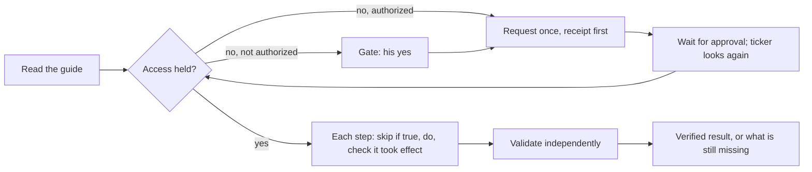

# Durable setup workflows: read the guide, get access once, set up, prove it

Section 6 of the plan. Task: read a shared document, work out what it needs, request missing access once, wait out an asynchronous approval, do the setup, and independently validate it. Opening a URL or clicking Submit is not completion.

`app/graph/setup.py` is a checkpointed graph on the existing engine (`engine.drive`), so a restart during a day-long approval wait loses nothing. `app/setup_flow.py` starts workflows, ticks waiting ones every ten minutes, and applies his gate answers. The front desk records "request it", "don't request it" and "signed in" for the one setup they can mean, and the ticker applies them.

| Failure | What happens |
|---|---|
| Access missing | One request. The receipt is claimed before submitting. An existing request (his, or a colleague's) is adopted, not duplicated. |
| Submitted, confirmation lost | The portal is searched. If found, its id is recorded. If not found, the run stops as uncertain and is **never resubmitted** on its own. |
| Approval takes a day, process restarts | The run ends while waiting. The ticker restarts it from the top, and each node first checks what is already true. |
| Request rejected | Stops with the request id. |
| Not authorized to request | Waits at a gate for his yes; his no declines. |
| Sign-in expired | Waits at a gate for him to sign in. Asta never types or stores a password. |
| Page changed / redirect off-site | Stops with what it saw. It does not guess at a new layout. |
| Step ran but did not take effect | Reported as not done. A submitting (`once`) step left uncertain is never repeated blind. |
| Validation fails | "Not set up", with the validator's evidence. |
| Secrets in pages or errors | Scrubbed from evidence and checkpoints. |

Authority comes from his instruction (`authorized = {"request_access", "setup"}`), never from the document.

**Testing and the live pilot.** The portal is an adapter looked up by name. Today the only one is the test fake (`tests/fake_portal.py`), which simulates every row above, and each outward act is counted on the portal's own side. A live adapter, for example over `app/sites.py` for a Decision Hub pilot, needs the real document, account and environment, and Arun's explicit instruction for the live access and setup actions. The historical example is not enough. Until then nothing here touches a real portal.

Limits: the guide-to-plan extraction is part of the adapter, so the live adapter must supply its own reading of each document. There is no brain-callable tool to start a workflow yet; that arrives with the live pilot.
