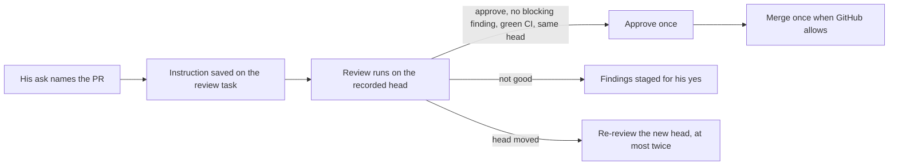

# One instruction for "review, approve and merge if good"

A standalone review used to end in two staged offers, post the review and then merge, each waiting for its own yes, although Arun had already said both. If the PR moved while the review ran, the findings were dropped ("Not staged: the PR head changed") and nothing reviewed the new head.

`review_pr` now saves one instruction on the review task when Arun's own words in that turn grant approve and/or merge **and** name that PR: a link to exactly that PR, or its number when he gave no link. The words are taken only from his turn, which the server binds. Tool arguments, the PR description and colleagues' messages cannot create or widen the instruction. It is stored in the database, so it survives restarts, and it goes stale after three days.

- **Condition:** only a verdict of approve with no blocking finding, on the exact head the task read and with green CI, is acted on. Anything else is staged for his yes as before.
- **No replays:** each approval and merge claims a receipt before it is sent. A timeout, cancellation or restart leaves an uncertain receipt, and that write is never sent again.
- **Revocation:** "don't merge" (with no number, a task number or a PR number) ends the instruction. Permission and policy rules are checked again immediately before each write. A revocation between the approval and the merge stops the merge.
- **GitHub rules:** his own PR is not approved, because GitHub forbids self-approval. Branch protection, required reviews and pending CI hold the merge, and the PR watcher retries the held merge later. Nothing is bypassed.
- **Head changes:** a new head is reviewed again under the same instruction, at most twice, after which it stops and comes back to him.

Limits: an uncertain approval or merge is not yet reconciled automatically against GitHub; it is reported and left alone. The named-person update after the merge (inform/follow-up) is a later stage. Tests use fake GitHub calls only; nothing was posted or merged on a real PR.
