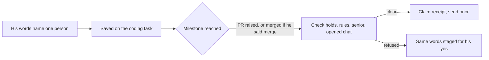

# Carry "…and inform Vinish" through a coding task

"Fix it, raise the PR, merge after CI and inform Vinish" was one instruction. The task kept the PR and merge parts (`go.py`) and dropped the last one. "Inform Vinish" reached a brain, which staged a draft, so Arun was asked again for the message he had just told Asta to send.

The named person is now saved on the coding task, read only from Arun's own words: the turn that spawned the task, or his go-ahead on it. A brief, a PR or a colleague's message cannot set it. That person is told once, when the milestone he named is reached: the merge if he asked for one, otherwise the PR.

- **Scope:** one exact 1:1 contact. Groups, "the team" and lists of names are not covered and go to his yes as before. A surname is used only when he capitalised it.
- **Checks:** before anything is typed, the send is checked against sends on hold, his standing rules, senior recipients and the chat Teams would actually open. If the opened chat is not clearly that person, the message is staged instead.
- **Delivery:** the send claims a receipt first. Concurrent milestones, restarts and repeated polls send it only once. An uncertain send is reported and never repeated.
- **Duplicates:** a draft the task's worker staged for the same person is dropped, because it would be the same news twice and a second ask.
- **Stopping:** "don't tell Vinish" (optionally with a task number) cancels it. Cancelled, rejected, failed and closed-unmerged tasks tell nobody.
- **Attribution:** the message is marked as Asta's own line, not Arun's words.

Limits: the message is a fixed one-line update (title, PR link, state), not a written summary. A "follow up with them until reviewed" part still goes through `followup.track` and is not started automatically from a coding task. An uncertain send is not reconciled against Teams history. Tests use fake Teams transports only; no real message was sent.
