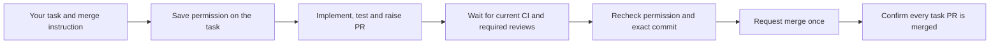

# Carry merge permission through a coding task

“Raise the PR and merge after checks pass” now records merge permission on the coding task alongside the existing shipping permission. Later plan approvals preserve it; `do not merge task N` revokes it. The PR watcher completes authorized merges when the task's own PRs satisfy current GitHub requirements, without asking the same question again. A plain request to raise a PR does not grant merge permission.

Merge execution now uses GitHub's `--match-head-commit`, rejects unknown mergeability, required-but-missing reviews, blocked branch state and unknown check conclusions, and reads back the result before claiming success. The task watcher requires actual configured checks for unattended merges. Policy rules and revoked permission are checked again immediately before the request.

A durable receipt is claimed before sending. A timeout, cancellation or restart does not replay an uncertain write. Read-only PR polling reconciles confirmed merges. Preflight rejection is distinguished from an uncertain request, so changed evidence can be checked again without another approval. A task with multiple PRs is complete only once all of them merge.

Scope: this completes authorized merge handling for Asta-owned coding-task PRs. It does not grant workers owner credentials, bypass GitHub restrictions, authorize a deployment, or remove the standalone arbitrary-PR tool's separate staging path. Unified scoped worker credentials and standalone multi-action PR workflows remain later stages.
