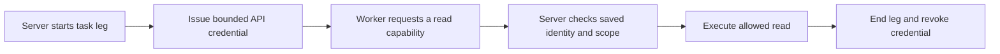

# Background worker API credentials

Previously every task received the owner API token and could choose its own task, conversation, user-message origin and read-only label in `/api/_invoke`. A worker could therefore reach owner operations despite the task's shell restrictions.

Each execution leg now receives a random two-hour API capability credential. Only its digest is stored alongside server-owned task, conversation, workspace and allowed tool scope. The invoke endpoint checks that record, forces read-only mode, rejects impersonated message/task/conversation metadata, binds project reads and task-status reads to the issuing task, and rejects unlisted capabilities. Other owner API routes do not accept worker credentials. Task completion, cancellation, workspace changes, expiry and explicit revocation invalidate the credential. Leg cleanup revokes it even after cancellation; concurrent legs use separate context bindings.

Task MCP configuration and the task subprocess environment carry this credential instead of the owner `ASTA_TOKEN`. The chat-tool floor cannot enlarge a worker's advertised tool set. A related workspace reader prefix-check bug is fixed: sibling directories and escaping symlinks are refused.

This is an API boundary, not complete worker isolation. Filesystem access, local credential stores, other provider credentials, unrestricted shell execution and independently configured MCP servers still need a real OS/process boundary. Some datasource reads remain broad within the explicit read allowlist; this change does not claim per-ticket, service or contact data isolation. Owner-authenticated chat requests retain their existing path.

Two writes stay in scope because they only stage for Arun's approval: `propose_pr_review` (review tasks are instructed to call it, and it is bound to the task's verified PR revision) and `prepare_to_send`, limited to a 1:1 chat draft to a named person, which is held with the task and shown labelled with it when the task ends. Group, email and recipient-less drafts are refused, because those land in the chat's own slot where an unrelated next "yes" could approve them unseen. These calls run with the task's identity and without the read-only flag; every other write is rejected.

Workers no longer invoke outward-action or authority-grant tools through Asta's API. They return results to the owning server workflow, which handles task replies and merges under saved permission. Standalone PR/communication action integration and a full task-scoped write service remain unfinished; do not restore an owner-token fallback to make a blocked worker write succeed.

Tests use synthetic credentials, isolated databases and fake capability functions. They cover forged identity, write attempts, owner-route bypass, expiry/revocation, stopped tasks, altered workspace, concurrent scope separation, cancellation cleanup and configuration/environment propagation. No live credentials or services are changed.
